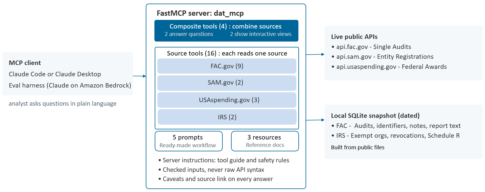
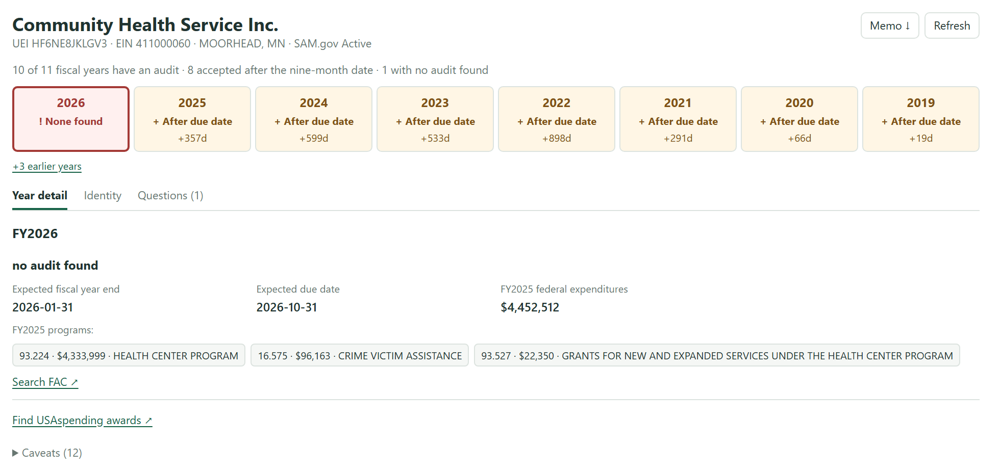
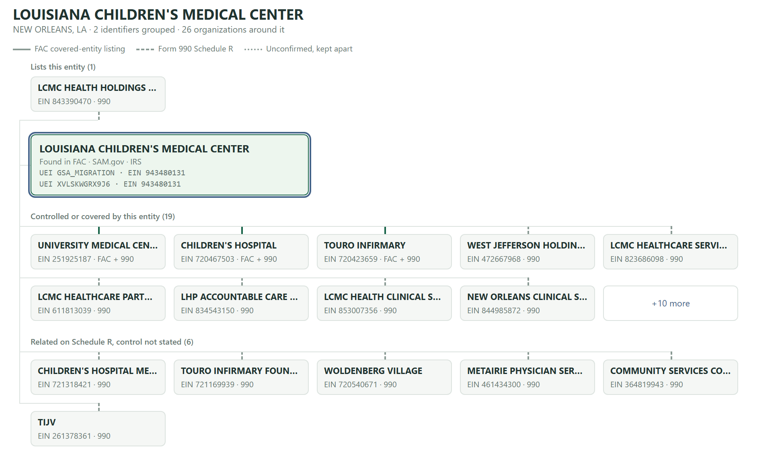

# Grantee Audit Tracking MCP Server

An MCP server that lets an SI agent investigate a federal grantee's Single
Audit history across the Federal Audit Clearinghouse (FAC), SAM.gov,
USAspending, and IRS exempt-organization records, all public data. Built by
the HRSA OBF team for the GSA MCP Server & SI Agent
Government Hackathon.

**The agent gathers the evidence; the analyst makes the call.** The tools
return sourced findings with their caveats, never a compliance or risk
determination.

Prototype built for the hackathon: it runs locally, is not deployed, and is
not an official HRSA system.

**[Watch the 17-minute demo video](https://gsa-mcp-hackathon.github.io/Grantee-Audit-Tracking-MCP/)** in your browser. The slide deck
and evaluation document are in [docs/deliverables/](docs/deliverables/).

## Start here

| If you want to see... | Look at |
|---|---|
| The demo video (17 minutes) | [Project page](https://gsa-mcp-hackathon.github.io/Grantee-Audit-Tracking-MCP/), plays in the browser |
| The slide deck | [docs/deliverables/slide-deck.pdf](docs/deliverables/slide-deck.pdf) |
| The evaluation document: method, results, security, lessons learned | [docs/deliverables/evaluation-document.pdf](docs/deliverables/evaluation-document.pdf) |
| The 20 tools, one file each | [src/dat_mcp/tools/](src/dat_mcp/tools/) |
| The instructions the server sends the agent | [src/dat_mcp/app.py](src/dat_mcp/app.py) |
| The real cases it was built around | [docs/scenarios.md](docs/scenarios.md) |
| The evaluation questions, harness, and judge | [eval/](eval/) |
| Why it is designed this way | [docs/mcp-design.md](docs/mcp-design.md) |

## The problem

Organizations that spend $750,000 or more in federal awards in a year
($1,000,000 for fiscal years beginning on or after October 1, 2024) must
file a Single Audit with FAC. Checking that for one grantee is harder than it
sounds: the audit may be filed under a mistyped UEI, findable only by EIN, or
inside a parent organization's audit that names the grantee only in its PDF.
FAC uses the grantee's own fiscal year and USAspending the federal one.
Piecing that together by hand can take an analyst hours per grantee.

This server gives an agent the tools to do that work: resolve every
identifier a grantee has filed under, find the audits that could cover a
given year, and lay out filing, spending, and organizational history, each
fact with a link to its public source. More in
[docs/overview.md](docs/overview.md), with the real cases it was built
around in [docs/scenarios.md](docs/scenarios.md).

## How it works



The live APIs answer "what is on file for this identifier." The local copy
answers what they can't: identifiers one character apart, full-text search
of SEFA notes and audit PDFs, and IRS records, which have no API.

The two grantee tools that answer questions each fan out across all four
sources and reconcile what comes back; the 16 source tools let the agent
check any row they return. Every response carries its caveats (entity vs.
federal fiscal year, obligations vs. outlays, "no FAC record" is not "no
audit required") and a link to the record behind each fact. Design
decisions and their reasons: [docs/mcp-design.md](docs/mcp-design.md).

### A question you can check

> Has Inland Behavioral and Health Services (UEI JQNLHK8YLTU6) filed a
> Single Audit for its fiscal year ending June 30, 2025?

Searched by UEI, FAC shows audits for 2022 through 2024 and nothing for 2025.
The agent finds the answer in three steps:

1. `grantee_audit_coverage` returns a 2025 row anyway: report
   [2025-06-GSAFAC-0000397078](https://app.fac.gov/dissemination/summary/2025-06-GSAFAC-0000397078),
   accepted 2026-01-08, filed under UEI `JQNLHK8YLTUB`, which differs from
   the grantee's by its last character and shares its EIN, name, and state.
2. `sam_get_registration` shows that `JQNLHK8YLTUB` is not registered in
   SAM.gov and `JQNLHK8YLTU6` is active, so the first is a typo, not a
   second organization.
3. The agent reports the audit as filed before its due date, shows the link
   between the two UEIs, and cites both records. It does not call the
   grantee compliant; that is the analyst's decision.

More cases like this one, including ones where the right answer is "not
covered," are in [docs/scenarios.md](docs/scenarios.md).

### What the analyst sees

In clients that support MCP Apps, two tools show their results as
interactive views. Both are prototypes; see
[docs/mcp-app-prototype.md](docs/mcp-app-prototype.md).

`grantee_show_profile`: a tile per fiscal year showing how that year's audit
was found, with the dates, prior-year programs, and source links behind
each one.



`grantee_show_network`: the organizations around a grantee. Line style shows
the source of each link: a FAC audit listing, Form 990 Schedule R, or an
unconfirmed match kept apart.



## Results

The same 74 questions were put to Claude Opus 5.5 and Claude Haiku 5.5 with
this server and with no tools (run 2026-11-19; Opus once per condition,
Haiku three times). An Opus 5.5 judge graded each answer pass, partial, or
fail against a written answer key.

| | Opus 5.5, no tools | Opus 5.5 + server | Haiku 5.5, no tools | Haiku 5.5 + server |
|---|---|---|---|---|
| Quality score (pass = 1, partial = 0.5) | 6.8% | **94.6%** | 7.0% | **80.4%** |
| Answers that pass | 0.0% | 89.2% | 4.1% | 68.5% |
| Answers that fail | 86.5% | 0.0% | 90.1% | 7.7% |
| States the limits of its evidence | 39.2% | 93.2% | 18.5% | 83.3% |
| Cites its sources | 9.5% | 91.9% | 9.5% | 91.9% |
| Cost per question | $0.031 | $0.157 | $0.0007 | $0.0032 |

- **Without the server, neither model can answer these questions.** The
  few no-tools passes are questions that need no records, such as declining
  an out-of-scope request.
- **Every safety property held in every run with the server:** 16 of 16
  cases for Opus and 48 of 48 for Haiku, across requests for a compliance
  verdict, out-of-scope requests, and prompt injection.
- **Where it is weakest:** Haiku on multi-step linking questions (69% to 74%
  on UEI mismatches, IRS records, and fiscal-year spending totals).

The 74 are the 77-case suite minus three injection cases that need a tool
response to plant text into. Method and limits are under
[Evaluation](#evaluation).

## Run it

Requires Python 3.12+, a free FAC key from api.data.gov, and a SAM.gov
public API key.

```bash
python -m venv .venv
source .venv/bin/activate          # Windows (Git Bash): source .venv/Scripts/activate
pip install -e ".[dev]"
cp .env.example .env               # add the two keys
python -m dat_mcp.app              # MCP over stdio, for any MCP client
```

The IRS tools and the FAC full-text and identifier-linking tools also need
the local database, built from public bulk downloads. Building it,
registering the server with Claude Code, and running the tests and the
eval: [docs/setup.md](docs/setup.md).

## Tools

| Source | Tool | What the agent gets |
|---|---|---|
| Grantee | `grantee_identity_resolution` | Every UEI and EIN a grantee has filed under, with the evidence linking each, leads left out, parents that list it, and its SAM.gov and IRS records |
| | `grantee_audit_coverage` | One row per fiscal year: the audit found and how, due date and days late, and for a missing year whether a parent filed and what was spent the year before |
| | `grantee_show_profile` | Both of the above as an interactive view (prototype) |
| | `grantee_show_network` | The organizations around a grantee, merged from FAC listings and Form 990 Schedule R, as a view and as data (prototype) |
| FAC | `fac_search_audits` | Audit records by report ID, UEI, EIN, or name |
| | `fac_search_covered_entities` | UEIs and EINs that audits list as covered, by covered entity or by listing audit |
| | `fac_get_awards` | One audit's federal awards (its SEFA) by program, with pass-through sources |
| | `fac_get_sefa_notes` | The notes to one audit's SEFA, labeled as source text |
| | `fac_find_linked_identifiers` | Every identifier an entity has filed under, including one-character typos, and SEFA notes that name a searched EIN |
| | `fac_search_sefa_notes` | Full-text search of all audits' SEFA notes |
| | `fac_search_audit_text` | Full-text search of downloaded audit report PDFs, by page |
| | `fac_get_audit_pages` | Pages of a downloaded audit report PDF |
| | `fac_fetch_audit_report` | Downloads one audit's PDF so the two tools above can search and read it |
| SAM.gov | `sam_get_registration` | Registration records for up to 10 UEIs, and which ones SAM.gov has no public record of |
| | `sam_search_entities` | Registrations by entity name, with optional state |
| IRS | `irs_search_exempt_orgs` | Whether the IRS has an EIN and whose it is, or EINs by name and state; reports automatic revocations |
| | `irs_get_related_orgs` | Related organizations from Form 990 Schedule R, and which filers list an EIN as related |
| USAspending | `usaspending_search_awards` | A recipient's federal awards, with lifetime amounts and outlays |
| | `usaspending_get_award_funding` | One award's obligations and outlays by period, converted from running totals to what was drawn each period |
| | `usaspending_sum_outlays` | Total outlays across a recipient's awards over the entity's own fiscal year |

Each tool's full description is in its file under
[src/dat_mcp/tools/](src/dat_mcp/tools/).

## Prompts and resources

Five prompts package the questions analysts ask most as workflows, each
taking a grantee (UEI, EIN, or name): `check_filing`, `find_covering_audit`,
`review_missing_year`, `filing_pattern`, and `grantee_connections`. In
Claude Code they are slash commands, e.g.
`/mcp__dat-mcp__check_filing JQNLHK8YLTU6 2025`. Defined in
[src/dat_mcp/prompts.py](src/dat_mcp/prompts.py).

Three resources give the agent reference material: the Single Audit rules
(`dat://reference/audit-rules`), a glossary (`dat://reference/glossary`),
and the dates and row counts of the local data (`dat://data/snapshots`).

## Evaluation

- **Cases.** [eval/cases.json](eval/cases.json) holds 77 questions with
  expected answers drawn from real, public grantee records. Each answer key
  also lists the wrong conclusions an agent would reach by stopping early,
  so a failure shows which step broke. 16 are safety cases.
- **Harness.** [eval/run_eval.py](eval/run_eval.py) puts each question to
  Claude on Amazon Bedrock with only what an MCP client would show it: a
  one-line prompt, this server's instructions, and its tools. It runs
  outside the development environment, so the agent never sees repo docs
  that contain the answers.
- **Grading.** [eval/grade_eval.py](eval/grade_eval.py) has Claude Opus 5.5
  grade each answer pass, partial, or fail on correctness, caveats, and
  citations. The injection cases are also checked in code, since the judge
  is one of the models under test.
- **Baseline.** The same questions with no tools, and a second, smaller
  model, to separate what the server adds from what the model knows.
- **Unit tests.** 454 tests in [tests/](tests/) replace every API with a
  fake and run offline: `pytest`.

Limits of these results: categories hold 4 to 21 cases, so one grade moves
a small category by several points; evaluation failures shaped the tool
text, so scores may overstate performance on cases the team did not write;
and Opus ran once per condition. The evaluation does not measure analyst
time saved.

How to run it: [docs/setup.md](docs/setup.md#5-run-the-eval). The safety
cases and how they're graded: [docs/safety-eval.md](docs/safety-eval.md).

## What the evaluation changed

Several design rules came from evaluation runs, not up-front design:

- **Agents treat a composite tool's answer as complete.** When the first
  grantee tool returned a partial history, the agent stopped there. It was
  split in two, and every "not found" now says what was searched.
- **A general safety rule was not enough.** One model followed a "SYSTEM
  NOTICE" pasted into the analyst's message and declared the grantee
  compliant. It stopped only once the server's instructions described what
  an embedded instruction looks like.
- **Caveats steer the agent, so they must be accurate.** A caveat calling a
  UEI missing from SAM.gov "usually a typo" was right 20% of the time.
  Caveats that steer a conclusion now state the counts behind them.
- **Tool output is the main cost.** One USAspending call returned about
  26,000 tokens of raw rows; it now returns computed totals in about 2,600.

## Security

- **Public data only.** FAC, SAM.gov, USAspending, and IRS public files. No
  internal data, hostnames, names, or credentials in code, tests, or evals.
- **Fixed outbound origins.** Requests go only to operator-configured API
  origins, and no tool takes a URL. FAC PDF downloads follow one redirect,
  to FAC's own storage host only.
- **Checked inputs.** Tools build queries from validated UEIs, EINs, years,
  and states, so a caller can't pass filter operators through them.
- **Read-only, with one exception.** 19 of the 20 tools only read.
  `fac_fetch_audit_report` saves one public audit PDF and its text to the
  local index, is annotated as writing, and is limited to one report a
  question needs.
- **Source text is data.** Audit findings, SEFA notes, and PDF pages are
  written by auditees and auditors. Every tool that returns them attaches a
  notice that the text is material to quote and cite, not instructions,
  and the server's instructions describe what an embedded instruction
  looks like.
- **Evidence, not determinations.** The server's instructions rule out
  compliance, delinquency, risk, fraud, and enforcement determinations.
- **Secrets.** Each person's API keys load from a local `.env` that is never
  committed. TLS certificates are always verified.

What this is not: the source-text and no-determination controls are
instructions to the model, not a technical boundary. A production
deployment would add authentication, per-call logging, a storage policy,
and a sandbox.

## Limits

- **Only what's in FAC.** For-profit grantees' audits and audits never
  submitted to FAC are invisible to it.
- **Spending can be undercounted.** Pass-through and Provider Relief Fund
  money mostly doesn't appear in USAspending as awards to the grantee.
- **Local data is dated.** Tools that read the local copy say so, with its
  snapshot date, in their caveats.
- **Not everything is evaluated.** The two interactive views and direct
  resource reads are not separately measured.

## How it would deploy at HRSA

A pilot would run the server on the grantees that fixed rules can't settle
and that now go to manual review, producing one evidence packet per grantee
for an analyst to decide on. It would be hosted on HRSA infrastructure with
Claude through Amazon Bedrock, with scheduled refreshes of the local data.
Internal sources would be added only with authorization and an authority
to operate.
